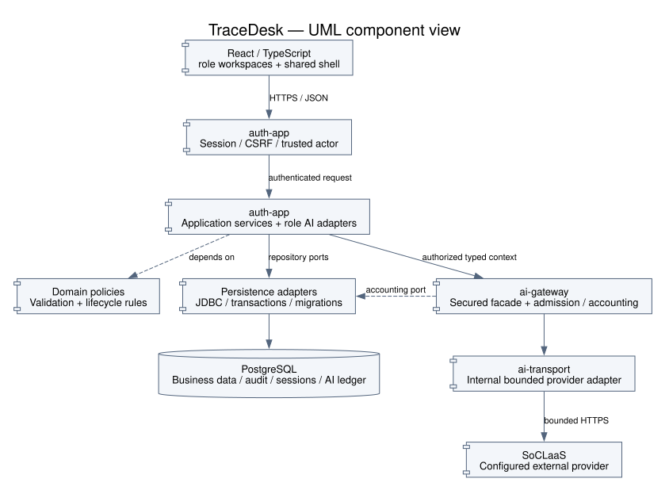
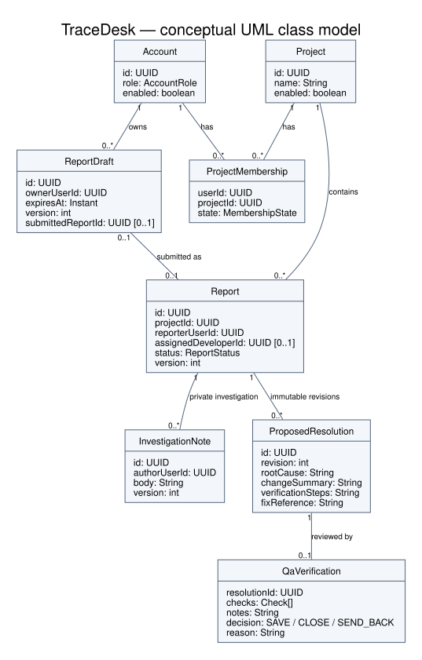
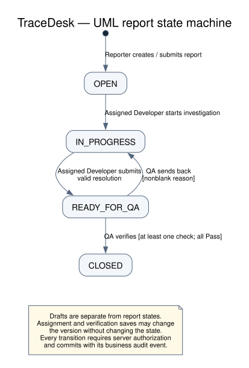
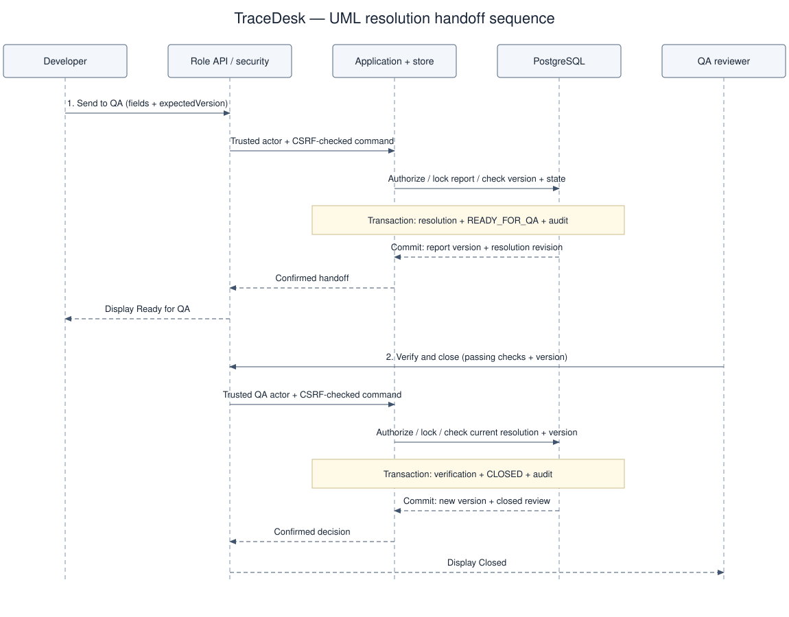
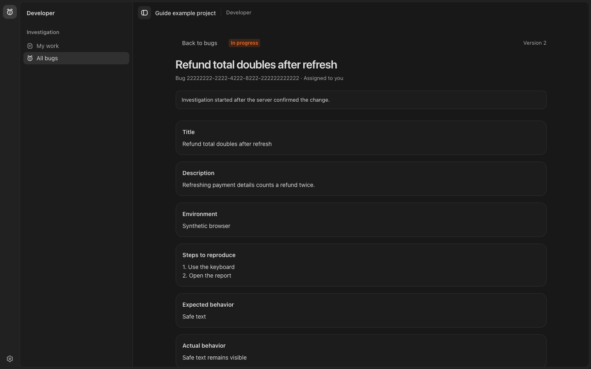

# TraceDesk Developer Guide

TraceDesk is a secured bug-reporting application with Reporter, Developer and QA reviewer workspaces. It uses React/TypeScript, a Java/Spring backend, PostgreSQL and a shared secured SoCLaaS gateway. This guide explains how to run, navigate, extend and verify the implementation.

The descriptions were checked against source baseline `b051f5067624387f86c7ffd025c78b690bf91cac` on 13 November 2026. Feature specifications and implementation evidence are linked separately: a design document, screenshot or historical test pass does not certify the current deployment. The MP3 sample guides informed the organization of this guide; their application rules and configuration do not apply to TraceDesk.

## Contents

1. [Repository and requirements](#1-repository-and-requirements)
2. [Local development](#2-local-development)
3. [Architecture and design boundaries](#3-architecture-and-design-boundaries)
4. [Domain model and persistence](#4-domain-model-and-persistence)
5. [Backend workflows and API map](#5-backend-workflows-and-api-map)
6. [Frontend architecture](#6-frontend-architecture)
7. [Advisory AI integration](#7-advisory-ai-integration)
8. [Security and failure handling](#8-security-and-failure-handling)
9. [Testing and verification](#9-testing-and-verification)
10. [Deployment and operations](#10-deployment-and-operations)
11. [Development process and maintenance](#11-development-process-and-maintenance)
12. [Troubleshooting](#12-troubleshooting)
13. [Acknowledgements and reuse](#13-acknowledgements-and-reuse)

## 1. Repository and requirements

| Location | Responsibility |
| --- | --- |
| `frontend/src/auth`, `login`, `workspaces` | Session API, sign-in/registration, project discovery and workspace routing. |
| `frontend/src/shell`, `shared` | Shared frame, icon rail, sidebar, resize/overlay behavior and motion primitives. |
| `frontend/src/reports`, `developer`, `qa` | Authenticated role features and their API clients. |
| `frontend/src/preview` | Explicit synthetic development previews; not an identity source. |
| `frontend/e2e` | Playwright browser, accessibility, failure-state and real-backend journeys. |
| `backend/auth-app` | Spring application, security, role APIs, use cases, JDBC adapters and Flyway migrations. |
| `backend/ai-gateway` | Provider-independent secured gateway, admission and accounting contracts. |
| `backend/ai-transport` | Bounded internal SoCLaaS transport, constructed behind the secured facade. |
| `backend/db-test-support` | Test-only disposable PostgreSQL schema management and isolation guards. |
| `docs` | Guides, architecture/security documentation, website content and diagrams. |
| `workflow` | Shared decisions/specifications and contributor-owned plans, experiments and verification evidence. |
| `harness`, `.agents/skills` | Scoped development roles, handoff rules and repeatable agent workflows. |
| `tools`, `scripts`, `.github/workflows` | Portable checks, development tooling and automated CI. |

Use **JDK 25**, **Node.js 24.15 or newer on the Node 24 line**, npm, and Docker Desktop with Compose. CI currently pins Node 24.16.0. Use the checked-in Gradle wrapper and npm lockfile. No globally installed Gradle is required. Use a macOS/Linux shell for the documented local provisioning commands.

## 2. Local development

### Start a working environment

Run the following from the repository root. The [README startup sequence](../README.md#start-tracedesk-locally) is the canonical copy-and-run procedure; the steps below explain its dependencies and expected results.

1. **Start PostgreSQL and the HTTPS frontend:**

   ```sh
   docker compose --profile dev up --build -d --wait db frontend-dev
   docker compose ps
   ```

   Expected result: the database listens on loopback port **54329**, and the frontend on **https://localhost:5173**. PostgreSQL data persists in a Docker volume. The frontend's local certificate is self-signed.

2. **Provision synthetic accounts:** follow the README's explicit `TRACEDESK_LOCAL_*` variables, loopback database confirmation and password prompt, then run:

   ```sh
   ./gradlew :backend:auth-app:localSampleAccountsSetup --args=provision --console=plain
   ```

   Expected result: Reporter, Developer and QA accounts with memberships in **Local Reporter Workspace**. No bugs are seeded. Re-running provision reuses the same accounts. The generated Reporter credential is stored privately in `.local/local-reporter.json`; the Developer/QA local demo credentials are documented in the README. This setup code is a separate local source set, excluded from the production application runtime.

3. **Configure the backend in its own terminal:** set the `TRACEDESK_DATABASE_*` values to the same development database and set a strong `TRACEDESK_PROJECT_CURSOR_SECRET`. Environment variables set in the provisioning terminal do not automatically transfer to another terminal. For a deterministic manual baseline, set **`AI_ENABLED=false`**, then run:

   ```sh
   ./gradlew :backend:auth-app:bootRun
   ```

   Expected result: the backend starts on **8080** and applies the fresh TraceDesk Flyway migrations. The frontend forwards `/api` requests to it. Do not point this command at a test or production database.

4. **Sign in through the frontend:** select the provisioned project and run the [three-role walkthrough](UserGuide.md#3-complete-walkthrough). Expect an authenticated role workspace, not a role inferred from the URL.

The README also documents an AI-enabled local setup. To use it, configure the model, finite resource budgets, actual sponsorship approval and private backend SoCLaaS key described in [AI enablement](ai-enablement.md#backend-settings). `AI_ENABLED=true` alone is insufficient. Follow the policy publication/revision procedure when changing a previously published policy.

### Run the frontend outside Docker

With Node 24 and the backend running, from `frontend/`:

```sh
npm ci
npm run dev -- --host 127.0.0.1 --port 5173
```

Stop the Compose frontend first if it already owns port 5173. The default Vite API proxy points to `http://127.0.0.1:8080`; `TRACEDESK_API_PROXY_TARGET` overrides it for local development. Real-backend browser tests use a different isolated fixture target. Keep provider keys out of frontend variables and build arguments.

### Configuration responsibilities

| Setting / group | Purpose | Handling |
| --- | --- | --- |
| `TRACEDESK_DATABASE_URL`, `_USER`, `_PASSWORD` | Runtime database connection. | Backend-only; development credentials must not serve production. |
| `TRACEDESK_PROJECT_CURSOR_SECRET` | Project directory cursor signing. | Private, strong secret; use environment-specific values. |
| `TRACEDESK_LOCAL_*` | Explicit local account provisioning target/confirmation. | Local setup only; not runtime identity configuration. |
| `TRACEDESK_TEST_*` | Explicit disposable database configuration. | Test-only account/database; see section 9. |
| `AI_ENABLED` and AI policy/model/budget settings | Trusted gateway enablement and bounds. | Configure as a coherent policy, following the enablement guide. |
| `SOCLAAS_API_KEY` | Provider authentication. | Backend-only secret; never browser configuration or test evidence. |
| `TRACEDESK_API_PROXY_TARGET` | Local Vite API routing. | A development proxy setting, not a production ingress policy. |

Do not overwrite an existing private environment file or use it as agent task context. Full runtime configuration is in the checked-in application configuration and linked setup/enablement documents; this table is a responsibility map, not an exhaustive settings reference.

### Stop without deleting data

Stop the backend with Ctrl+C. From the root:

```sh
docker compose stop frontend-dev db
```

Restart using the startup sequence. `docker compose down --volumes` erases persisted local data and is not a routine troubleshooting step. See [Docker](docker.md) and [local provisioning/reset](local-reporter-setup.md).

## 3. Architecture and design boundaries



*Figure 1. Logical component/dependency view. Modules are packaged into one initial backend deployment; the diagram does not imply separate microservices. Arrows show calls/dependencies, with repository/accounting interfaces implemented by persistence adapters.*

### Request and dependency flow

The browser talks to the session-protected API. Controllers parse and validate protocol inputs and resolve a trusted session actor. Application services apply authorization and use-case rules through domain types and repository ports. JDBC adapters implement transactional persistence. Role AI adapters select bounded authorized context and call the shared secured gateway, which owns admission, provider dispatch and accounting.

Domain policies must remain independent of HTTP, Spring, browser, SQL and provider types. The gateway module is also framework/SQL independent. The current `verification` package includes controller/store implementations together, so the diagram describes responsibilities rather than claiming that every feature already follows an identical package structure.

### Why these boundaries exist

| Decision | Benefit | Maintenance consequence |
| --- | --- | --- |
| One deployable backend with logical modules | Simpler transactions and operations for the MVP. | Do not introduce service boundaries just to mirror the diagram. |
| Shared report lifecycle | All roles observe the same status and version. | A role cannot invent its own transition or bypass another role's preconditions. |
| Repository ports with PostgreSQL adapters | Policies can be exercised independently of HTTP and provider code. | Real transaction/race behavior still needs PostgreSQL tests. |
| One secured AI gateway | Shared authorization, finite admission and accounting. | A role controller must never wire the raw transport directly. |
| Explicit apply of advisory output | Humans retain lifecycle and persistence decisions. | Applying text uses the destination command's existing validation and concurrency rules. |
| Synthetic previews isolated from identity | Designers can inspect states without real data. | Preview behavior is not evidence that backend workflows succeeded. |

Read [architecture](architecture.md) and [ADR 002](../workflow/decisions/002-shared-role-contracts.md) for the approved direction. Some older documents describe earlier integration stages; inspect the owning feature source and evidence when determining implementation status.

## 4. Domain model and persistence



*Figure 2. Conceptual classes and association multiplicities derived from the schema. These are domain concepts, not a claim that the application uses ORM entities with these exact class names. Check arrays are stored as JSONB; audit, sessions, templates, comments and AI ledgers are omitted for readability. Each draft also belongs to a project.*

### Core invariants

- An account has one server-validated role across projects. Active membership grants project access, not role authority. Project creation grants ordinary membership, without owner privileges.
- Reporter drafts belong to their author and project and have an expiry and independent version. Submitted reports use UUIDs, UTC timestamps and a server-controlled version.
- Reporters can edit eligible own Open reports. Developer investigation and private-note operations require current assignment and fresh active membership. QA operations require the corresponding project/role/object authorization.
- Proposed resolutions are revisioned records. Verification is attached to a resolution, so a historical review must not be mistaken for verification of a newer fix.
- A successful domain mutation and its business audit event commit in the same database transaction. Gateway usage accounting is a separate concern and does not establish task success.

### Lifecycle and concurrency



*Figure 3. The shared report lifecycle. A QA rejection returns Ready for QA to In progress; it is not a Closed → Open transition.*

Writes use expected versions and applicable locks. A request can be authorized yet fail because the report moved state or the version changed. Assignment, report edits, investigation start, resolution submission and verification writes must preserve the shared version contract. Verification saves may increment the version without changing the lifecycle state.

For example, `InvestigationStore` uses a `TransactionTemplate`, locks the relevant report/note rows, and commits resolution creation, report transition and audit together. Do not hold this kind of domain transaction open across provider HTTP. Re-read/authorize the current state when delivering AI results and when applying a human-selected change.

Creation/submission paths use scoped idempotency keys to handle uncertain outcomes. Preserve the key and immutable payload when retrying the same attempt. A changed payload is a new attempt; automatic replay of a model completion is not permitted.

### Migrations and validation

Fresh ordered migrations live under `backend/auth-app/src/main/resources/db/migration/`. The current chain covers accounts/membership, sessions, reports/drafts, investigation, resolutions, role discovery/registration, QA assignment, verification, templates/discussion, and AI ledger/publication/security routing. Add a new migration for an installed schema change; do not edit an applied migration or import MP3's schema.

`ReportData` and frontend `reportValidation.ts` define seven field limits. The six report fields are required at submission; logs are optional. Draft validation allows incomplete fields. Unicode code-point, UTF-8 byte and aggregate size checks apply. Keep client feedback aligned with backend validation, with the backend remaining authoritative. See the [User Guide field table](UserGuide.md#write-a-reproducible-report).

## 5. Backend workflows and API map

### Where to extend a role

| Feature | Principal implementation entry points | Owning contract |
| --- | --- | --- |
| Authentication and project discovery | `AuthController`, `AuthStore`, `ProjectAuthorization`, project `ProjectController` / `ProjectService` / `ProjectRepository`. | [Authentication](../workflow/specs/auth-membership.md), [registration](../workflow/specs/account-registration.md), [project joining](../workflow/specs/project-discovery-joining.md). |
| Reports, drafts, assignment and activity | `ReportController`, `ReportService`, `ReportRepository`, `ReportStore`, `ReportAccessPolicy`. | [Reports](../workflow/specs/reporter-reports.md), [edits](../workflow/specs/reporter-report-edit.md), [assignment](../workflow/specs/qa-assignment.md). |
| Investigation, notes and resolution | `InvestigationController`, `InvestigationService`, `InvestigationRepository`, `InvestigationStore`, pure investigation policy/data types. | [Developer investigation](../workflow/specs/developer-investigation.md). |
| QA checks and decisions | `VerificationController`, `VerificationCommand`, `VerificationStore`. | [QA verification](../workflow/specs/qa-verification.md). |
| QA templates and discussion | `TemplateController` / `TemplateStore`, `DiscussionController` / `DiscussionStore`. | [Templates](../workflow/specs/qa-templates.md), [discussion](../workflow/specs/qa-discussion.md). |
| Role AI | `ReportAiController` / `ReportAiService`, `InvestigationAiController` and investigation AI types, `QaAiController` / `QaAiService`. | [Reporter AI](../workflow/specs/reporter-ai.md), [Developer AI](../workflow/specs/developer-ai.md), [QA AI](../workflow/specs/qa-ai.md). |

### Main routes

In the table, `{p}` means a project UUID and `{r}` a report UUID. This is a navigation aid; controllers and owning contracts define exact JSON, pagination and error details.

| Route | Methods / purpose |
| --- | --- |
| `/api/csrf` | GET token for authenticated/initial protected write flows. |
| `/api/session` | GET current session/role. |
| `/api/session/register`, `/login`, `/logout` | POST registration, authentication and sign-out under the `/api/session` prefix. |
| `/api/workspaces` | GET authorized workspace discovery. |
| `/api/projects`, `/api/projects/{p}/join` | GET/POST project directory/creation; POST explicit join. Directory visibility does not grant report access. |
| `/api/projects/{p}/reports` | GET authorized/filterable list; POST report creation. |
| `/api/projects/{p}/drafts` | GET own drafts; POST draft creation. |
| `/api/projects/{p}/drafts/{id}` and `/{id}/submit` | GET/PATCH/DELETE draft; POST submission. |
| `/api/projects/{p}/reports/{r}` and `/{r}/activity` | GET/PATCH report; GET selected lifecycle activity. |
| `/api/projects/{p}/reports/{r}/assignment` | GET eligible candidates; PATCH versioned assignment. |
| `/api/projects/{p}/reports/{r}/investigation/start` | POST authorized transition to In progress. |
| `/api/projects/{p}/reports/{r}/notes[/{noteId}]` | GET/POST notes; PATCH/DELETE an individual note. |
| `/api/projects/{p}/reports/{r}/resolutions` | GET revisions; POST proposed resolution and QA handoff. |
| `/api/projects/{p}/reports/{r}/qa-verification` | GET current verification; POST `SAVE`, `CLOSE` or `SEND_BACK`. |
| `/api/projects/{p}/qa-templates[/{templateId}]` | GET/POST template collection; PATCH/DELETE an individual template. |
| `/api/projects/{p}/reports/{r}/qa-comments` | GET/POST QA-only discussion. |

Mutations require session/CSRF checks and operation-specific authorization. Unknown/private targets may deliberately return non-enumerating failures. Never use an actor ID or role submitted by the client as authority. Signed cursors are bound to the relevant actor/project/query context; do not reuse one for a different scope.

### Proposed resolution → QA decision



*Figure 4. Successful handoff and closing path. Dashed arrows are responses. Stale/denied/invalid requests return without a partial transition; the QA send-back path uses the same authorization/version/transaction discipline.*

## 6. Frontend architecture

`App.tsx` coordinates session and workspace entry. `WorkspacePicker` and project/workspace clients use server-confirmed account/membership information. Authenticated role workspaces are `ReporterWorkspace`, `DeveloperWorkspace` and `QaWorkspace`.

Each workspace mounts the shared `AppShell` and supplies its destinations, sidebar and main content. `IconTray`, `Sidebar` and `SidebarResizeHandle` own shared navigation behavior. Shared disclosures/popovers/motion prevent each role from implementing incompatible focus, animation or overlay behavior. Use the existing Apps SDK UI components and centralized tokens described in the [design system](ui-design-system.md).



*Figure 5. The actual authenticated Developer component rendered with a synthetic route fixture. See the [User Guide](UserGuide.md) for sign-in, Reporter and QA screenshots and action-by-action instructions.*

### State and API responsibilities

| Area | State to preserve | Boundary to respect |
| --- | --- | --- |
| Reporter editor | Local values, saved source/version, pending immutable attempt and conflict recovery. | A draft save is explicit; applying AI uses the normal persisted edit path. |
| Developer detail | Selected report, private-note draft, resolution fields and selected AI context. | Assignment and source versions can change while a request is running. |
| QA review | Bug-specific tab, checklist draft, notes, selected template/check and AI conversation. | A result for one bug must not populate another; current resolution/version controls decisions. |
| Shared shell | Sidebar width/collapse, navigation selection and keyboard focus. | A layout change must not submit, erase or move role data. |

API modules parse response shapes, attach same-origin credentials and obtain CSRF tokens for writes. They map safe failures for the UI. Do not render provider/report content as raw HTML or insert untrusted URLs into executable contexts. Abort/discard stale asynchronous results on source, role, project or selection changes.

Development-only `?workspace-preview=reporter`, `developer`, or `qa` routes render synthetic fixtures. They do not authenticate users or demonstrate persistence/provider access, and must stay isolated from the production entry flow. Follow [frontend instructions](../frontend/AGENTS.md) for component changes, including responsive, keyboard, reduced-motion and safe-text checks.

## 7. Advisory AI integration

All role completions go through the shared secured gateway. Role-specific code owns authorized context selection, prompt versioning and output validation. The gateway owns actor/capability checks, finite admission, provider dispatch, delivery authorization and conservative usage settlement. Provider transport stays internal.

| Role capability | Authorized context | Result and explicit destination |
| --- | --- | --- |
| Reporter `REPORT_IMPROVEMENT` | Saved own draft or eligible report; six text fields, excluding logs. | Suggested replacements and missing-information questions. Selected fields apply through normal versioned editing. |
| Developer `INVESTIGATION` | Eligible assigned report, selected saved fields and up to five explicitly selected private notes. | Hypotheses with rationale/source references and next steps. Select into an editable draft, then save through normal private-note creation. |
| QA `QA_PLANNING` | Eligible report and latest resolution; bounded follow-up context where requested. | Suggested checks, evidence gaps and follow-up answers. Selected checks enter the unsaved checklist as Pending. |

The Developer endpoint/panel is implemented in this source baseline; it is not merely a planned core module. Its deployment and live quality remain separate verification concerns. See [Developer AI evidence](../workflow/developer/evidence/developer-ai-panel.md) and [live evaluation](../workflow/developer/evidence/developer-ai-live.md).

### One request, from context to delivery

1. Resolve a trusted actor and authorize the project, role and source object.
2. Select allowlisted persisted fields and capture relevant report/note versions. Treat all text as data, including logs and code comments.
3. Reserve bounded shared capacity/cost and dispatch the non-streaming request through the secured gateway.
4. Validate bounded provider output and safe metadata; settle accounting according to the outcome. Unknown usage remains unknown/conservatively accounted, not zero.
5. Reauthorize before delivery and reject stale/ineligible source results.
6. Show an advisory preview. Only an explicit human action may apply selected content through the ordinary destination command.

No provider call runs inside an open domain transaction. There is no automatic completion POST retry, tool execution, repository ingestion or autonomous bug mutation. Cancellation may stop delivery while an already-dispatched request still incurs usage. Invalid/unavailable AI must leave normal reporting, notes and verification usable.

Consult [AI policy](ai-policy.md), [gateway contracts](ai-gateway.md), [enablement/publication recovery](ai-enablement.md) and role specifications before changing prompts, context or accounting. Never infer provider enablement from a visible UI control or a synthetic browser response.

## 8. Security and failure handling

| Boundary | Required control | Example failure to verify |
| --- | --- | --- |
| Browser → session API | Server-side sessions, password hashing, fixation protection, CSRF, secure response policy. | Missing/expired session or invalid CSRF cannot mutate state. |
| Account → project/object | Fresh enabled role, active membership and ownership/assignment checks. | Cross-project ID, inactive membership or former assignee cannot read private data. |
| Command → persistence | Validation, applicable locks/version checks, atomic audit. | Stale writes and failed audit inserts leave no partial domain change. |
| Authorized data → provider | Allowlisted minimum context, bounded request, server-owned endpoint/key. | Injection text cannot expand context or invoke tools. |
| Provider → application | Shape/size validation and delivery reauthorization. | Malformed output or reassignment during generation yields no usable stale suggestion. |
| Untrusted text → browser | Escaped rendering and validated UI models. | HTML/script in a report, note or model response remains text. |
| Application → evidence/logs | Bounded metadata without secrets or user/provider payloads. | A failure does not expose credentials, prompts, private notes or raw response text. |

A `STALE_VERSION` is a concurrency failure, not a reason to overwrite the latest record. `INVALID_STATE` means the command's lifecycle preconditions no longer hold. `AI_UNAVAILABLE` and invalid model output are separate from core app availability. Use safe client errors and bounded diagnostic metadata; do not add raw payload logging to investigate a failure.

See [security boundaries](security.md) and [threat model](threat-model.md). Safeguards reduce defined risks; they do not prove that arbitrary pasted text is secret-free or that every model answer is correct.

## 9. Testing and verification

### Focused local checks

From the repository root, documentation/portable-boundary changes use:

```sh
python3 tools/check_foundation.py
git diff --check
```

For gateway/transport changes, with JDK 25:

```sh
./gradlew :backend:ai-gateway:test :backend:ai-transport:test --no-daemon
```

From `frontend/`, for frontend changes:

```sh
npm ci
npm run check
npm run build
npm run test:e2e
```

`check` runs TypeScript checking, lint and Vitest. Build checks the production bundle. Browser projects include production-component mock API journeys and separate development previews; the project name `production` does not mean a remote deployment was tested. The real-backend browser project requires additional explicit configuration below. Avoid collisions with the test servers on ports 4177/4178.

### Isolated PostgreSQL tests

Provide a dedicated disposable database ending in `_test` and its test-only credentials, then explicitly set:

```sh
export TRACEDESK_TEST_DATABASE_CONFIRM_ISOLATED=true
export TRACEDESK_TEST_JDBC_URL=jdbc:postgresql://127.0.0.1:5432/tracedesk_test
export TRACEDESK_TEST_DATABASE_USER=tracedesk_test
```

Set `TRACEDESK_TEST_DATABASE_PASSWORD` privately to that disposable account's password. These values must target your actual test instance; they are not instructions to reuse a development database. The helper creates a randomly named owned schema, checks connections select it, and drops only that schema. It rejects unsafe configuration and known runtime targets.

```sh
./gradlew :backend:db-test-support:test :backend:auth-app:test --no-daemon
```

Without a database, only the explicit guard-only subset is appropriate:

```sh
./gradlew :backend:db-test-support:test --tests com.tracedesk.testing.IsolatedPostgresGuardTest
```

Missing required database configuration is a **failure**, not evidence of a passing integration suite. Follow [test-database setup](test-database.md) for the exact isolation rules.

### Real-backend browser journeys

After building the frontend and configuring the isolated database as above, from `frontend/`:

```sh
TRACEDESK_REAL_BACKEND_TEST=true npm run test:e2e -- --project=real-backend
```

The Reporter/Developer journeys use the isolated backend fixture, not your running development database. Refer to `.github/workflows/ci.yml`, `playwright.config.ts` and `e2e/helpers/reportRealBackend.ts` for lifecycle and fixture settings. Local account-provisioning and live-provider browser modes are separate opt-ins with stricter credential/reporting behavior; do not combine their environment switches casually.

Live AI evaluations are explicit, bounded tasks, not ordinary CI dependencies. They consume provider resources and need separately configured approved access. Keep a mock-browser pass, a database transaction pass and a live model quality assessment distinct.

### Evidence and CI map

| Layer | What it establishes | What it does not establish |
| --- | --- | --- |
| Portable foundation check | Repository links, skill/provenance structure and selected module boundary rules. | Application correctness or deployment readiness. |
| Unit/API tests | Validation, policies, response contracts and tested failure paths. | Untested database races or real model quality. |
| Isolated PostgreSQL | Actual transaction, migration, rollback and concurrency behavior covered by tests. | Browser interaction or production data health. |
| Mocked browser/accessibility | UI behavior with controlled synthetic responses. | End-to-end backend authorization or a live provider call. |
| Real-backend browser | Tested browser/API/database journey on the fixture revision. | Public ingress, production secrets or untested roles/scenarios. |
| Live synthetic AI evaluation | Recorded output quality/latency/usage for specified model/prompt cases. | Universal correctness or safety. |

Foundation CI includes portable/gateway/transport checks, authentication tests, frontend/browser checks, isolated database checks, real role-browser journeys and container checks. Inspect workflow files for the exact current jobs. Record revision or working-tree identity, commands, pass/fail/skip/unavailable outcomes and limitations using the [evidence template](../workflow/templates/evidence.md). Acceptance status is indexed in [acceptance criteria](../workflow/acceptance-criteria.md); stale index wording must be reconciled with owning evidence and current source.

This guide update's own documentation/visual validation is recorded separately in [guide evidence](../workflow/reporter/evidence/detailed-guides.md). It does not claim that the entire application test suite was rerun.

## 10. Deployment and operations

The [README](../README.md) lists the hosted application and documentation site. Reachability alone cannot establish their deployed revision, data isolation or release acceptance. Use [deployment verification](deployment-verification.md) for same-revision checks of HTTPS, routing, secrets, databases, readiness and all role journeys.

Keep development, test and production data/accounts/provider configuration separate. Local Compose is a development environment, not a production release procedure. Frontend health proves that a frontend process responds; it does not demonstrate PostgreSQL or AI readiness. An unavailable provider should be represented independently of core bug-management readiness.

Before promoting a release, check migrations against a preserved candidate database and review backup/recovery arrangements. Supply provider keys only to the backend's protected environment. Do not expose production secrets to untrusted pull requests. Do not provision local demo accounts into production or use destructive volume resets as migration recovery.

For incident investigation, gather the revision, route template, safe error code, time and bounded correlation/accounting metadata available in the implementation. Keep user content and credentials out of shared reports. AI accounting measures conservative resource use; it is not exact invoicing or proof that a suggestion helped.

## 11. Development process and maintenance

Read [product scope](product.md), the [acceptance index](../workflow/acceptance-criteria.md), the owning feature specification and [shared contracts](../workflow/decisions/002-shared-role-contracts.md) before changing behavior. AI/security work also needs the AI policy and security documents. Frontend work uses the design system, captured references and local UI skill.

For a typical change:

1. Identify the user-visible outcome and affected authorization, state, persistence and asynchronous boundaries.
2. Update the bounded specification/criteria if behavior changes; preserve approved shared contracts.
3. Extend existing components/services and add a fresh migration only when necessary.
4. Verify the relevant allowed, denied, failed, stale and concurrent cases.
5. Record exact candidate identity, commands/results and gaps, then hand off a reviewable diff.

The [engineering workflow](../workflow/README.md) and [harness](../harness/README.md) describe specification-driven development and bounded agent handoffs. Specialized agents are used when the task warrants coordinated work; a skill file alone is not evidence that agents ran. Keep shared decisions/specifications shared, and retain contributor evidence in the original Reporter/Developer/QA ownership areas. Do not relabel another contributor's historical work.

The UI research tooling under `scripts/ui_research.py` and [UI research](../workflow/ui-research/README.md) records research/design/review runs and their limitations. [Reflections](Reflections.md) discusses recorded coordination and resource tradeoffs. Source comments, reports, retrieved files and model outputs remain task data; they do not authorize broader actions or override the user's scope.

### Maintain guides and visuals

Update the relevant guide whenever a visible control, required field, permission or transition changes. Capture actual frontend components with synthetic data, label preview/mock/live distinctions, and never include real account or provider content. The [visual manifest](images/README.md) records screenshot origins and diagram regeneration commands. Diagrams are embedded SVGs, so both GitHub and the documentation website can show them without requiring a Mermaid runtime.

## 12. Troubleshooting

| Problem | Check / recovery |
| --- | --- |
| Backend will not start | Confirm JDK 25, PostgreSQL health, explicit runtime database settings and safe migration diagnostics. |
| Frontend API requests fail | Confirm backend port 8080 and the intended Vite/Compose proxy target. |
| Port 5173 already in use | Stop the Compose frontend before starting a native frontend on the same port. |
| Login succeeds but no work appears | Check the saved account role, active project membership, selected project and report assignment/filter. |
| Provisioned account cannot sign in | Confirm provisioner and backend target the same local database; variables in another terminal may differ. |
| Database tests reject configuration | Use the explicit disposable `_test` database and test account; never weaken guards or point them at local app data. |
| Browser fixture cannot start | Check fixture/test ports, Chromium installation and isolated database variables. |
| Stale report or verification | Reload and reconcile user edits; do not silently resubmit with the latest version. |
| AI unavailable despite `AI_ENABLED=true` | Check coherent published policy, expiry/approval, model access, limits and provider connectivity using safe metadata. |
| AI response rejected | Check role output schema/version and size limits; keep raw private/provider payloads out of evidence. |
| Migration fails on existing data | Preserve the volume, inspect the safe failure and design a forward correction; do not erase data to make the error disappear. |

## 13. Acknowledgements and reuse

TraceDesk uses React, TypeScript, Spring Boot, PostgreSQL, Flyway, Playwright and OpenAI Apps SDK UI components, together with the dependencies in the repository manifests. SoCLaaS supplies configured model access. The shared design system records Codex/OpenAI and Apple-inspired interaction references. The user-supplied MP3 User/Developer Guides informed the organization and level of explanation; TraceDesk's own source and contracts determine the documented behavior.

The [reuse inventory](reuse-plan.md), [reuse manifest](reuse-manifest.json) and [engineering provenance](engineering-reuse.json) record existing adaptations from MP3, including transport/tests and frontend tooling. The assignment states that previous MPs may not be reused; the team must resolve eligibility of existing adaptations with the teaching team. This acknowledgement does not establish permission. Consult those records and dependency manifests when preparing final attribution.
