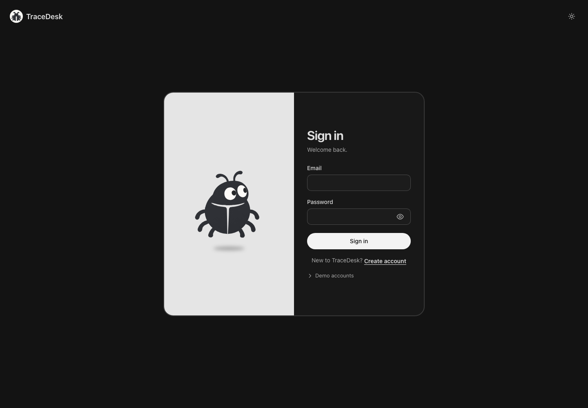
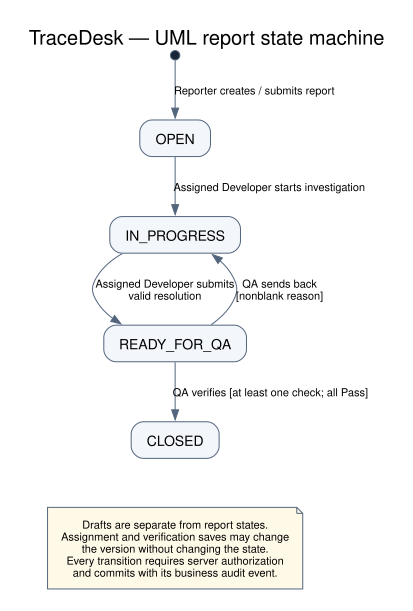
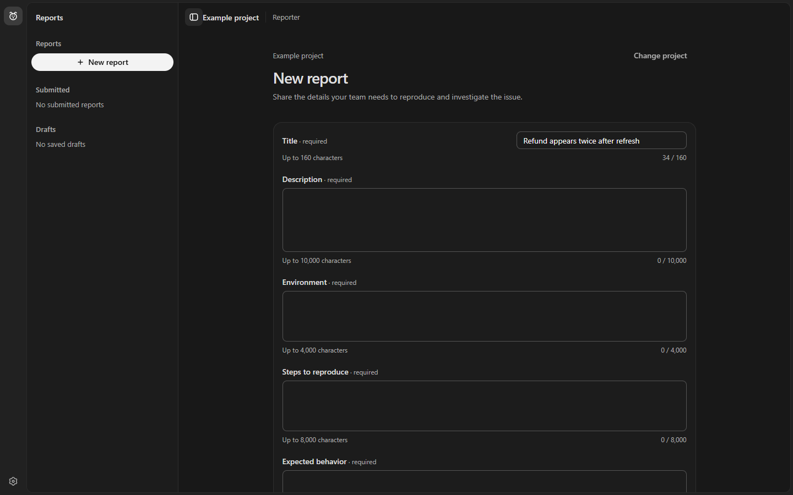
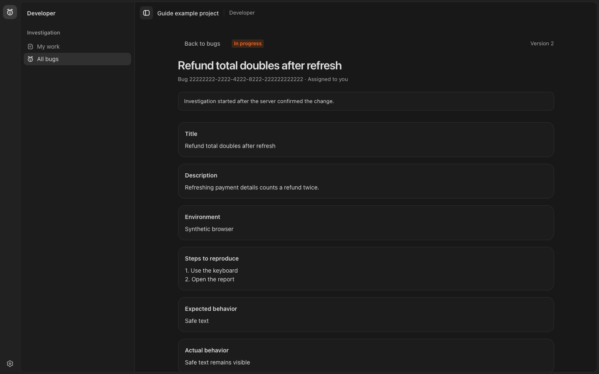
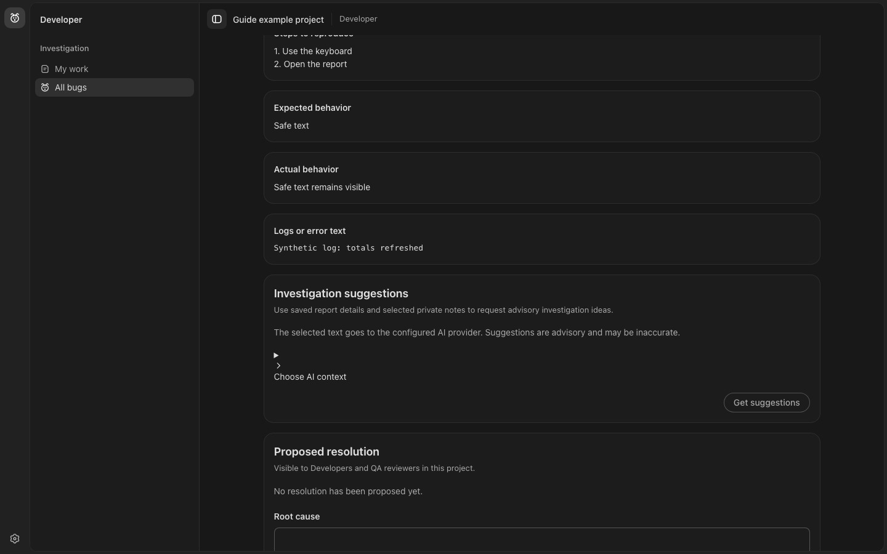
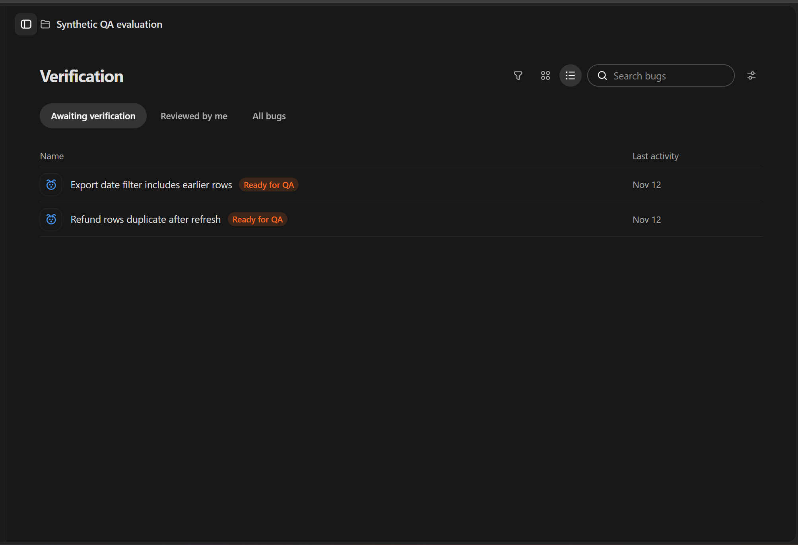

# TraceDesk User Guide

TraceDesk helps a team report a software bug, investigate its cause, and verify a proposed fix. This guide explains the Reporter, Developer, and QA reviewer workflows, including what must be saved and what happens when an action fails.

The instructions describe the repository version accompanying this guide. Screenshots use synthetic local data; names, report IDs and available actions will differ in your project. A screenshot illustrates the interface and does not prove a live deployment or successful AI call.

## Contents

1. [Access and first sign-in](#1-access-and-first-sign-in)
2. [Roles, navigation and report states](#2-roles-navigation-and-report-states)
3. [Complete walkthrough](#3-complete-walkthrough)
4. [Reporter: create and track reports](#4-reporter-create-and-track-reports)
5. [Reporter: improve a report with AI](#5-reporter-improve-a-report-with-ai)
6. [Developer: investigate and propose a resolution](#6-developer-investigate-and-propose-a-resolution)
7. [Developer: request investigation suggestions](#7-developer-request-investigation-suggestions)
8. [QA: assign a Developer and review a fix](#8-qa-assign-a-developer-and-review-a-fix)
9. [QA: templates, discussion and review history](#9-qa-templates-discussion-and-review-history)
10. [QA: use AI review](#10-qa-use-ai-review)
11. [Appearance, accessibility and sign-out](#11-appearance-accessibility-and-sign-out)
12. [Troubleshooting](#12-troubleshooting)
13. [Glossary and current limits](#13-glossary-and-current-limits)

## 1. Access and first sign-in

### Open TraceDesk

The repository [README](../README.md) lists the [hosted application](https://tracedesk-run-660566661066.asia-southeast1.run.app). Its availability and deployed revision have not been independently verified during this documentation update. Use the address supplied by your project operator if it differs.

For local use, follow [Start TraceDesk locally](../README.md#start-tracedesk-locally). The default frontend address is **https://localhost:5173**. Local setup requires Docker, JDK 25 and the setup steps in the README. Only accept a self-signed certificate warning for the local environment you intentionally started.

*Figure 1. Local sign-in screen. No real account credentials are shown.*

### Sign in or create an account

1. Enter the email and password provisioned for your environment, then select **Sign in**.
2. Select an accessible project when prompted. The account's saved role determines the workspace; changing a URL or project does not change your role.
3. To register, select **Create account**, enter an email-shaped login, password and confirmation, and choose **Reporter**, **Developer**, or **QA reviewer**. Complete registration, then sign in.
4. Registration creates an account without project membership. Use the project picker to create or explicitly join an available project. Joining grants ordinary membership; creating a project does not grant extra administrator powers.

The same account role applies across projects. An existing account cannot change its role through registration. If a project or action is unavailable, check membership and account status before retrying.

### Local sample accounts

After the README's local provisioning command succeeds, the local sample accounts are:

| Role | Login | Password source |
| --- | --- | --- |
| Reporter | `reporter.local@tracedesk.invalid` | Generated locally in the private `.local/local-reporter.json` file. |
| Developer | `developer@tracedesk.test` | Local demo password: `tracedesk-demo`. |
| QA reviewer | `qa@tracedesk.test` | Local demo password: `tracedesk-demo`. |

These accounts belong to **Local Reporter Workspace** after provisioning. The demo shortcuts require these real local accounts; they do not bypass authentication. Do not assume these credentials work on a hosted environment. Keep the Reporter credential file private. Sign out before switching accounts.

## 2. Roles, navigation and report states

| Role | Start here | Main responsibilities | Important boundary |
| --- | --- | --- | --- |
| Reporter | **Reports** → **New report** | Create reports, save drafts, edit eligible own reports and follow activity. | Editing stops when a report leaves Open. |
| Developer | **My work** or **All bugs** | Investigate assigned bugs, save private notes and propose resolutions. | Viewing a bug does not grant permission to investigate it. |
| QA reviewer | **Verification** or **Test templates** | Assign Developers, record checks, close a verified bug or send it back. | A closing decision requires at least one check and every check to pass. |

The left icon rail selects an area; the sidebar contains that area's navigation or report list. Select **Toggle sidebar** to expand or collapse it. On small screens, select a navigation item or press Escape to dismiss the overlay. Settings contains appearance/account controls. Use the project controls to change project context, saving work first.

*Figure 2. Report state machine. Drafts are separate saved work and are not submitted reports.*

| Visible state | Meaning | Next lifecycle action |
| --- | --- | --- |
| Open (`OPEN`) | Submitted and waiting for investigation. | QA assigns a Developer; that Developer starts investigation. |
| In progress (`IN_PROGRESS`) | Assigned Developer is investigating or revising a rejected fix. | Developer sends a proposed resolution to QA. |
| Ready for QA (`READY_FOR_QA`) | A proposed resolution is available for verification. | QA closes it or sends it back with a reason. |
| Closed (`CLOSED`) | QA accepted the fix after verification. | Review recorded information; this guide does not describe a Closed → Open action. |

Saving a note, changing an assignment or saving QA checks is not necessarily a state transition. Wait for a confirmation before assuming a write succeeded.

## 3. Complete walkthrough

Use a synthetic issue such as **Refund total doubles after refresh** to try the full workflow. All three accounts must be members of the same project.

1. **Reporter:** create a report explaining that a synthetic refund is counted twice after refreshing payment details. Include numbered reproduction steps, browser/build information, expected total and observed total. Select **Create report**. Expected result: a submitted **Open** report appears.
2. **QA reviewer:** open **All bugs**, select that report, and use **Manage assignment** to assign an eligible Developer. Expected result: the current Developer updates after confirmation.
3. **Developer:** find the report in **My work**, open it and select **Start investigation**. Save a note recording the reproduction. Expected result: **In progress**, with a saved private note.
4. **Developer:** reproduce and fix the issue in your development environment. In **Proposed resolution**, enter the root cause, change summary and verification steps, then select **Send to QA**. Expected result: **Ready for QA** with a resolution revision.
5. **QA reviewer:** open the report from **Awaiting verification**. Add checks for a single refund, multiple refunds and repeated refreshes. Run them against the relevant build and record **Pass** or **Fail**. Select **Save verification** if pausing.
6. **QA reviewer:** if all checks pass, select **Verify and close**. Otherwise, enter a reason and select **Send back to Developer**. Expected result: **Closed**, or **In progress** with the recorded rejection.
7. **Reporter:** reopen the report details and inspect its status and activity. The Developer's private notes and QA-only discussion are not Reporter activity content.

AI is optional at each stage. This walkthrough can be completed without an AI response. TraceDesk records your work; it does not run your application, apply a source-code patch or execute verification checks for you.

## 4. Reporter: create and track reports

### Write a reproducible report

1. Select **Reports**, then **New report**.
2. Complete the six required fields below. Add **Logs or error text** only if useful.
3. Select **Create report** to submit, or **Save draft** to continue later.
4. Wait for confirmation. A submitted report starts **Open**; a saved draft stays in the draft list.

*Figure 3. Existing synthetic browser capture of the report form. Scroll to reach the remaining fields and save/submit controls.*

| Field | What to include | Maximum characters |
| --- | --- | ---: |
| Title | A short symptom, for example “Refund total doubles after refresh”. | 160 |
| Description | What goes wrong and its impact. Separate observations from guesses. | 10,000 |
| Environment | Application build, OS/browser and relevant test configuration. | 4,000 |
| Steps to reproduce | Numbered steps, prerequisites and synthetic inputs. | 8,000 |
| Expected behavior | What should happen, including the expected result. | 4,000 |
| Actual behavior | What happened instead, including a safe error message. | 4,000 |
| Logs or error text | Optional, small relevant excerpts with credentials removed. | 16,000 |

The app also checks UTF-8 size and request limits. Whitespace-only required fields are invalid. Do not paste credentials, access tokens or sensitive production records into any field.

### Save, resume or delete a draft

Drafts can be incomplete. They are saved **only when you select Save draft**; typing is not an automatic save. Open a saved draft from the draft list, make changes, then save again. The interface shows its saved version and expiry. An expired draft cannot be edited or submitted. The current implementation allows up to 20 active unsubmitted drafts per user/project.

Before selecting **Submit as report**, save all changes and complete the required fields. Submission creates the actual report; saving alone does not. Use the draft's delete action only when you no longer need it, and follow any confirmation shown.

If a save or submission has an **unconfirmed** outcome, use the offered **Retry draft save** or **Retry submission** action. It retries the same attempt. Avoid creating a second report to work around a connection failure.

### Edit a submitted report safely

Open your report and use its edit action while it is still **Open**. Select **Save changes** when finished. If the server reports a newer version, review the current data first. The recovery controls let you discard local edits or keep them after reviewing the current version. Keeping local edits can replace all seven report fields; compare carefully. Editing is unavailable once investigation starts.

### Track progress

Use the report list's status filter, open a submitted report, and inspect its status and activity. Activity can include creation, edits, investigation start, proposed resolution and QA decisions. It is a selected lifecycle history, not a complete copy of all audit records or private work.

## 5. Reporter: improve a report with AI

**Before starting:** save a draft or open an eligible own report. AI reviews persisted content, so save new changes first.

1. Select **Review with AI** and read the provider disclosure.
2. Request suggestions when AI is available. Selected report fields go to the configured provider; Reporter AI excludes the separate logs field.
3. Read proposed replacements and missing-information questions. Check that the model did not invent a build, reproduction step or observation.
4. Select only useful field changes and choose **Apply selected changes**.
5. Check the confirmed saved result. Applying suggestions uses the normal version-checked edit operation and does **not** submit a draft as a report.

If the source changes while AI is running, refresh and request suggestions for the current saved version. Missing-information questions are prompts for you to investigate; they are not evidence that you supplied the information. See [Reporter AI details](reporter-ai.md) for context selection and limits.

## 6. Developer: investigate and propose a resolution

### Find assigned work and start

1. Open **My work** for assigned reports or **All bugs** to browse accessible project reports.
2. Select a report and read the reproduction details, environment and logs.
3. Confirm that it is assigned to you. If not, ask the project's QA reviewer to manage assignment.
4. On an eligible Open report, select **Start investigation**. Wait for confirmation that it is **In progress**.

*Figure 4. Current Developer workspace using a synthetic API fixture. The confirmed version and assignment appear with the report.*

### Keep private investigation notes

Scroll to the investigation area, enter findings in **Add a private note**, and select **Save note**. Existing notes offer edit/delete controls when permitted. Save useful observations, small snippets or reproduction results; changes are not saved merely by typing.

Private notes are restricted to the current assigned Developer. Reassignment removes the previous assignee's access. A Reporter or QA reviewer does not receive private-note text through their report views. Put information needed for QA into the proposed resolution explicitly.

*Figure 5. AI and resolution controls below the report details. Suggestions require a separate request and explicit save.*

### Send a proposed resolution to QA

In **Proposed resolution**, provide:

| Field | Purpose | Limit |
| --- | --- | --- |
| Root cause | Explain the confirmed cause rather than only repeating the symptom. | 4,000 characters |
| Change summary | Describe what changed and why it addresses the cause. | 4,000 characters |
| Verification steps | Give QA reproducible actions and expected outcomes on the fixed build. | 4,000 characters |
| Fix reference | Optional short commit, PR or build reference. | 200 characters |

Select **Send to QA**. On success, the app records a resolution revision and moves the bug to **Ready for QA**. Filling this form does not change source code or deploy a fix. If QA sends the bug back, read the decision/reason for that revision, investigate further and submit a new resolution when ready. Previous resolution revisions remain available for review.

## 7. Developer: request investigation suggestions

On an eligible assigned investigation, scroll to **Investigation suggestions**.

1. Open **Choose AI context**. Select saved report fields and, optionally, up to five saved private notes. Logs are not selected by default.
2. Read the disclosure and select **Get suggestions**. At least one report field must be selected.
3. Review each hypothesis, its rationale and source references, and the suggested next steps. These are ideas to test, not confirmed diagnoses.
4. Select useful items, then **Add selected to draft**.
5. Edit the **Editable private-note draft**, then select **Save private note**. Nothing is persisted until this save succeeds.

**Cancel suggestions** stops waiting locally; a request already sent may still count toward usage. If context is too large, deselect fields/notes or save a concise relevant excerpt as a note. If AI is unavailable or returns an invalid result, continue with ordinary notes and investigation.

## 8. QA: assign a Developer and review a fix

### Choose the right queue

Open **Verification**. **Awaiting verification** contains work ready for QA; **Reviewed by me** helps you find completed reviews; **All bugs** includes reports that may still need assignment or investigation. Search for the report by title or the identifier displayed in the workspace.

*Figure 6. Existing synthetic QA capture. Queue contents and account-specific filters depend on your project.*

### Assign, reassign or clear a Developer

1. Open the report Summary from **All bugs**.
2. Under **Developer assignment**, select **Manage assignment**.
3. Select an eligible Developer from the current project's candidates. Candidates may be displayed as IDs.
4. If replacing or clearing an existing assignment, enter a nonblank reason, up to 500 characters, and select **Save assignment**.
5. Wait for **Developer assignment updated**. If eligibility or the report changed, select **Refresh assignment** and review the new choices.

Closed reports show the recorded assignment without assignment mutation controls. Directory membership alone is insufficient: the target must be an enabled, active, same-project Developer.

### Prepare and save verification

1. Open a **Ready for QA** report. Read the original report and the latest proposed resolution.
2. Select **Verification**. Add checks with unique, meaningful titles, or apply a suitable template.
3. Choose **Board** or **List** to inspect checks. Select a check to record **Pending**, **Pass**, or **Fail**, and optional notes.
4. Perform each check yourself against the relevant fixed build. Record build information and overall findings in **Verification notes**.
5. Select **Save verification** to persist a review in progress. Saving preserves the **Ready for QA** state.

A review supports up to 30 checks, titles up to 300 characters, per-check notes up to 250 characters and overall notes up to 2,000 characters. Template and AI additions enter the local draft as Pending and must be saved.

### Close or send back

**Verify and close** becomes available when there is at least one valid check and all checks are **Pass**. Select it only after actually running the checks. A successful decision moves the report to **Closed**.

For an incomplete or failed fix, enter **Reason for sending back** and select **Send back to Developer**. Explain the failing step, observed result and build. A successful decision returns the report to **In progress**. A Fail result alone does not send the report back; the explicit decision does.

If a version conflict occurs, review the latest report and use **Reload verification** or **Discard edits and reload** as offered. Copy any useful unsaved observations to a safe place before discarding them. Completed decisions are read-only for that resolution revision.

## 9. QA: templates, discussion and review history

### Reuse a test template

Open **Test templates**, choose **New template**, enter the name and available guidance/check fields, then select **Save template**. Edit an existing template when shared guidance changes; use its delete action only when it is no longer needed.

To use one, return to a report's **Verification** tab, choose the template and select **Apply**. Check the resulting Pending checks and save the verification draft. Applying a template copies its guidance into the review; later edits or deletion of that template do not rewrite the copied checks. Templates do not run tests or record passes automatically.

### Discuss a review

Use **Discussion** to post human review comments, such as missing reproduction evidence or the build tested. Comments are for active QA reviewers in the project. They are not Developer private notes or Reporter-visible messages. Keep secrets and production data out of comments.

### Inspect previous decisions

Use the available review-history controls to inspect resolution revisions and their recorded checks, notes and decisions. Historical reviews help explain why a fix was accepted or returned. Review the latest resolution before making a new decision; an old passing review does not establish that a new revision passes.

## 10. QA: use AI review

1. On an eligible report, select **Review with AI**, read the disclosure and request a review.
2. Read the suggested regression checks and evidence gaps against the original report and latest resolution.
3. Ask a follow-up in the panel if needed. Follow-ups are additional AI requests.
4. Select useful suggestions and choose **Add selected to Verification**.
5. Inspect the added Pending checks, execute them, record results and save verification yourself.

The panel sends selected report/latest-resolution text to the configured provider. It does not run a test, inspect a repository, verify the Developer's claims or make the close/send-back decision. If a suggestion is stale or inappropriate, leave it unselected. Switching bugs should not apply another bug's suggestions.

## 11. Appearance, accessibility and sign-out

Use **Settings** → appearance controls to select light, dark or system appearance where offered. Collapsing or resizing the sidebar does not submit or save work. On narrow screens, panels may stack and navigation opens as an overlay.

Use Tab to move between controls and Enter/Space to activate the focused control. Escape dismisses supported overlays and returns focus to navigation. The interface respects the operating system's reduced-motion preference. Scroll inside the workspace to reach lower form sections; a hidden lower control may simply be below the current scroll position.

Save your work and select **Sign out** before another person uses the device or before signing in with another role. If your session expires, sign in again; do not assume an interrupted save was accepted.

## 12. Troubleshooting

| Symptom | Likely explanation | What to do |
| --- | --- | --- |
| Sign-in fails | Wrong credentials, missing local provisioning, disabled account or unavailable backend. | Check the environment and account details; local users should confirm the README setup completed. |
| No accessible project | Registration does not automatically join a project. | Create or explicitly join an available project, or ask the operator to check membership. |
| Report cannot be edited | It is no longer Open, you do not own it, or access changed. | Refresh the report and inspect its state and account. |
| Developer cannot start investigation | The report is unassigned, assigned to someone else or no longer eligible. | Ask QA to check assignment, then refresh. |
| Save/submission outcome is unconfirmed | A connection failed before confirmation arrived. | Use the offered retry for the same attempt; do not create duplicates. |
| Newer version / report changed | Another action updated the report or review. | Review current data and use the offered recovery/reload controls before saving again. |
| AI unavailable | Disabled AI, access policy, budget/capacity or provider failure. | Continue manual work; report persistent failures to the operator without sharing secrets. |
| AI context too large | Selected text exceeds the bounded input. | Reduce selected fields/notes and use concise excerpts. |
| Verify and close disabled | No checks, a Pending/Fail result, invalid/duplicate titles or stale review. | Complete and validate checks, then refresh if required. |
| Draft cannot be resumed | It expired, was deleted/submitted, or access changed. | Refresh the draft list and check its displayed expiry/state. |
| Local frontend loads but API fails | Backend/DB not running or ports do not match. | Follow the README troubleshooting steps; keep the database volume intact. |

## 13. Glossary and current limits

| Term | Meaning |
| --- | --- |
| Draft | A separately saved, expiring Reporter work item that has not yet become a report. |
| Assignment | The current Developer responsible for investigation; managed by QA. |
| Resolution revision | A recorded proposed fix with root cause, summary and verification instructions. |
| Verification | QA checks and a saved decision for a particular resolution. |
| Version | A server-controlled number used to detect conflicting updates. |
| AI suggestion | Advisory generated text that requires review and explicit application. |

The current scope supports pasted text/snippets/logs, not automatic repository ingestion, arbitrary code execution or autonomous patching. AI availability depends on backend enablement, valid provider access and finite budgets; see [AI enablement](ai-enablement.md). The README currently includes AI setup, and also explains how to run with AI disabled. None of the ordinary bug workflows requires AI.

For implementation, setup and testing details, see the [Developer Guide](DeveloperGuide.md). Screenshot origins and diagram maintenance are recorded in the [guide visual manifest](images/README.md).
